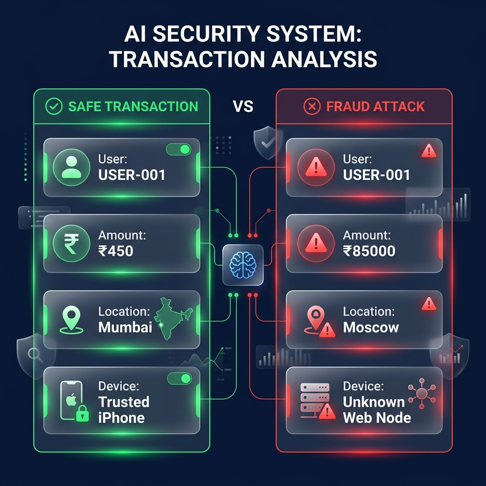
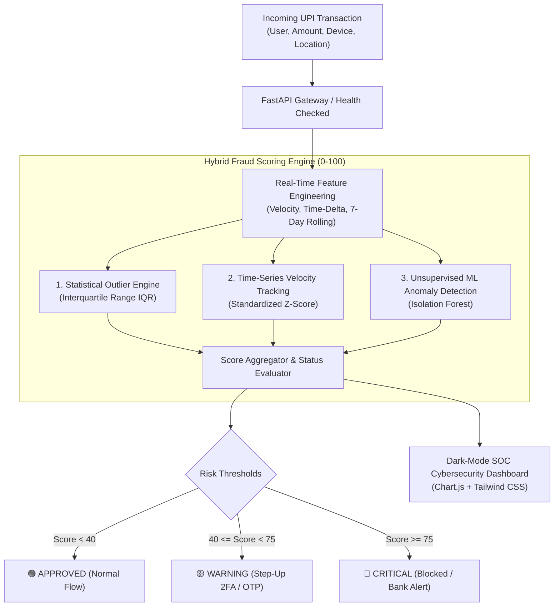

# 🚨 Real-Time UPI Fraud Detection & MLOps System

[](https://upi-fraud-engine-u8uo.onrender.com/)
[](https://github.com/swarnim6336/UPI-Fraud-Detection/actions/workflows/ci.yml)




An enterprise-grade, real-time Machine Learning and statistical inference engine designed for detecting fraudulent UPI (Unified Payments Interface) transactions. Built with **Python, FastAPI, Scikit-Learn, Docker, and Kubernetes**.

---

## 🏛️ System Architecture



---

## 📐 Mathematical Formulation

Unlike black-box models, this system pairs **statistical determinism** with **unsupervised machine learning** to minimize false positives:

### 1. Interquartile Range (IQR) Baseline Modeling
For each user's historical spend distribution, the upper threshold is calculated as:
$$\text{IQR} = Q_3 - Q_1$$
$$\text{Threshold}_{\text{upper}} = Q_3 + 1.5 \times \text{IQR}$$
Transactions exceeding this boundary trigger an immediate +40 score penalty.

### 2. Standardized Velocity Z-Score
Detects rapid automated bot attacks and transaction bursts within a 1-hour window:
$$Z = \frac{x_{\text{1h}} - \mu_{\text{velocity}}}{\sigma_{\text{velocity}} + \epsilon}$$
When $Z > 2.0$, a velocity anomaly penalty is flagged.

### 3. Isolation Forest Anomaly Scoring
Evaluates high-dimensional behavioral shifts across transaction amount, time since last transaction, device ID change, and location hopping. Anomaly score:
$$s(x, n) = 2^{-\frac{\mathbb{E}(h(x))}{c(n)}}$$
where $\mathbb{E}(h(x))$ is the average path length across random trees and $c(n)$ is the average path length of unsuccessful searches in a Binary Search Tree.

---

## 🐳 Running with Docker & Docker Compose

### Option A: Single-Command Docker Compose (Recommended)
Spins up the FastAPI fraud detection engine and a Redis cache instance:

```bash
docker compose up --build
```
Open **`http://localhost:8000`** in your browser to view the live SOC dashboard and interactive tester.

### Option B: Standalone Docker Container
```bash
# Build the production image
docker build -t upi-fraud-engine:latest .

# Run container with port forwarding and healthchecks
docker run -d -p 8000:8000 --name upi-engine upi-fraud-engine:latest
```

---

## ☸️ Kubernetes Deployment

Declarative manifests are provided in [`infra/k8s/`](infra/k8s/):
* `deployment.yaml` — 2 replicas, resource requests/limits, liveness & readiness health probes.
* `service.yaml` — Load-balanced internal service abstraction.
* `hpa.yaml` — Horizontal Pod Autoscaler scaling from 2 to 10 pods when CPU crosses 70%.

Deploy to your cluster:
```bash
kubectl apply -f infra/k8s/
```
*(For complete Minikube walkthrough, see [KUBERNETES_GUIDE.md](KUBERNETES_GUIDE.md))*

---

## 🧪 Automated Testing Suite

The repository includes a complete test harness built with `pytest`:
* **Statistical Unit Tests:** Verifies IQR boundaries, Z-Score thresholds, and Isolation Forest constraints.
* **API Integration Tests:** Verifies `/health`, `/api/predict`, schema validations, and HTTP error handling.

Run tests locally:
```bash
pytest tests/ -v
```

---

## 🛠️ Tech Stack & DevOps Tooling

* **Language:** Python 3.11+
* **Machine Learning:** `scikit-learn`, `numpy`, `pandas`, `joblib`
* **API Framework:** `FastAPI`, `Uvicorn`
* **Containerization:** `Docker`, `Docker Compose`
* **Orchestration:** `Kubernetes` (Deployments, Services, HPA)
* **CI/CD:** `GitHub Actions`
* **Frontend:** `Tailwind CSS`, `Chart.js`, `HTML5`
* **Cloud Hosting:** `Render` (Live Web Service)

---

## 📄 License
MIT License. Developed for high-performance financial systems engineering.
